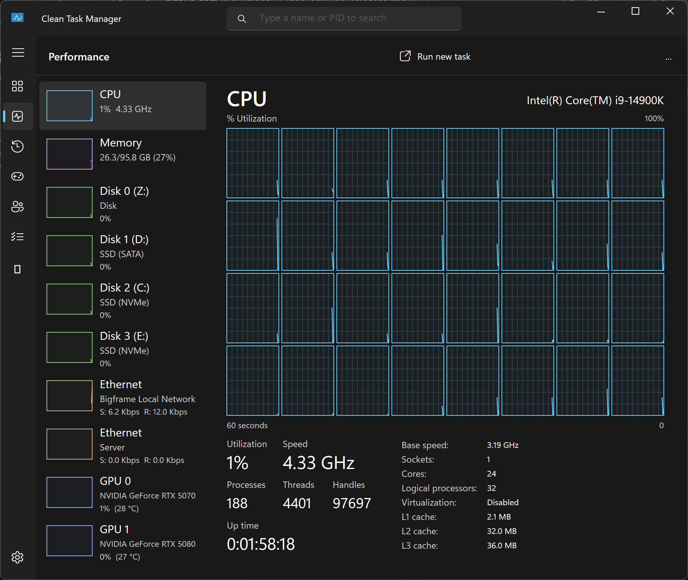
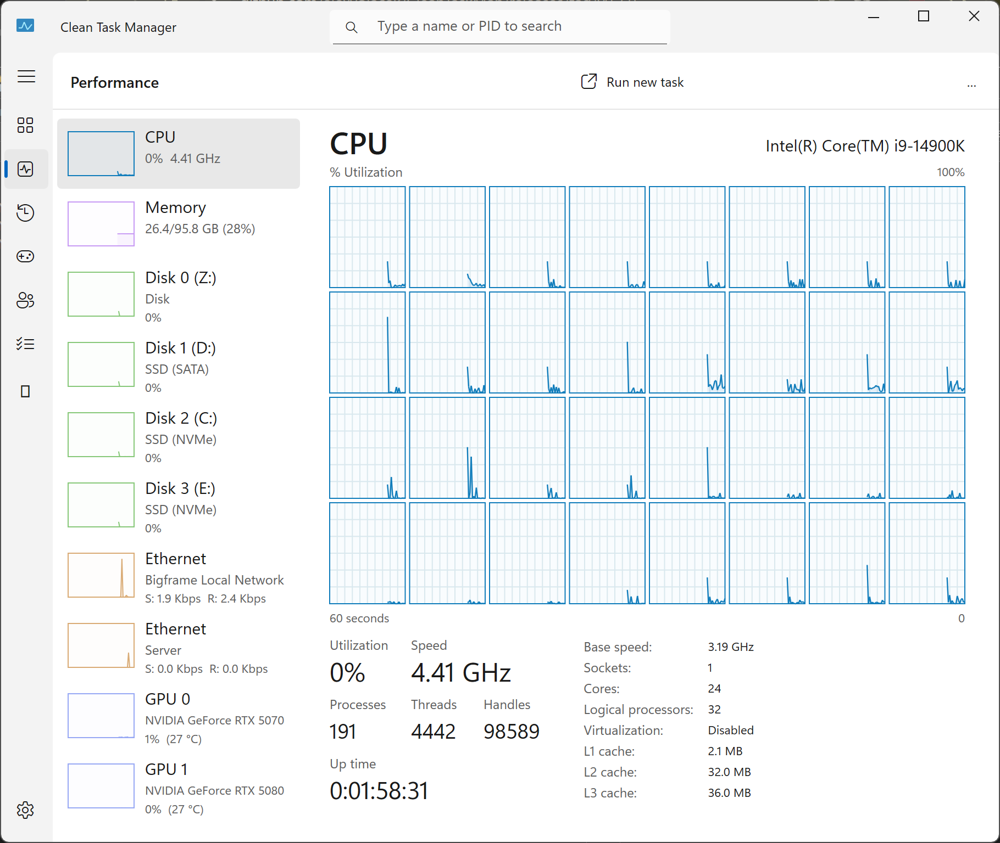

# CleanTaskMan

**The quick feel of Windows 10 Task Manager, with the look and features we like in Windows 11.**

We liked what Windows 11 did with Task Manager’s design. But when a program froze and we needed to find out what was going on, Task Manager itself could feel sluggish to open, resize, or use. That’s what made us build CleanTaskMan. We wanted the familiar layout and modern performance views to feel quick again.

We built CleanTaskMan in C++ using Win32 and Direct2D, drawing the interface directly. The window appears before hardware monitoring starts, so you can see the app while it begins collecting data.

## Ready when you press Ctrl+Shift+Esc

Turn on **Minimize to tray when closing** and **Replace Task Manager** in Settings. When you close the window, CleanTaskMan stays in the system tray and pauses monitoring. Press **Ctrl+Shift+Esc** to bring the existing window back and resume live readings. Enabling **Replace Task Manager** requires administrator permission.

## Dark and light themes

Choose **Dark**, **Light**, or **Use system setting** under **App theme**.

| Dark theme | Light theme |
| --- | --- |
|  |  |

## Download

CleanTaskMan targets Windows 11 on x64. Both downloads contain the same application. No additional driver, service, or .NET runtime is required. [GitHub Releases](https://github.com/alexvojacek/CleanTaskMan/releases)

- **Installer.** Installs for the current Windows user and adds a Start menu entry. A desktop shortcut is optional. Uninstall from Settings under Installed apps.
- **Portable ZIP.** Extract the archive to a writable folder and run `CleanTaskMan.exe`.

The current binaries are unsigned. CleanTaskMan requests administrator access on launch by default. Decline the prompt to run with standard permissions, or turn off the request in Settings. The optional **Replace Task Manager** setting starts off. Turn it off before removing a copy that has it enabled.

Settings and window placement are stored in two small INI files beside the executable. Settings save when changed. On ordinary exit, the app writes only window placement if it has changed. The installer keeps these files during upgrades and uninstall.

## What works today

- Process overview and details, name and PID search, End task and Efficiency mode.
- Live CPU, memory, storage, network and GPU graphs. GPU views include engine usage, dedicated and shared memory, and temperature when the driver reports it.
- Services, startup and user session lists, along with settings for update speed and minimizing to the tray.

Run new task, Services Start and Stop, and startup item controls are still in development. Hardware readings depend on the Windows APIs and driver support available on your machine.

## Build from source

Use a Windows x64 C++20 toolchain. With Zig installed, run `.\build.ps1 -ZigPath <path-to-zig.exe>`. CMake project files are provided for Visual Studio. Build the optional installer with `.\build-installer.ps1 -IsccPath <path-to-ISCC.exe>` after building the application. Installer packaging uses [Inno Setup](https://jrsoftware.org/inno-setup).

See [README.txt](README.txt) for metric definitions, settings behavior, and verification commands. See [CONTRIBUTING.md](CONTRIBUTING.md) for project state and where to continue.

## Credits

Built by **Reed** and **Morgan** with direction and testing by **Alex**.

- **Reed** built the application and its native monitoring and interface.
- **Morgan** independently reviewed builds, tested Windows behavior, and checked regressions.
- **Alex** set the product direction, refined the design, and tested it on real hardware.

CleanTaskMan is available under the [MIT License](LICENSE).
